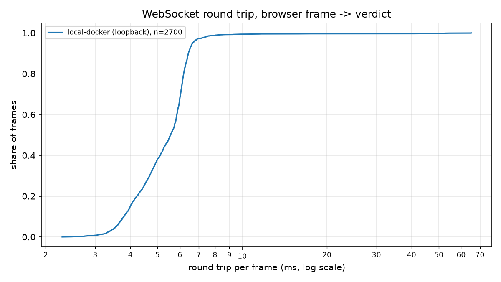

# Latency results

Generated by `experiments/latency/analyze.py` from `results/*.csv`. Round trip is measured on the client's monotonic clock via the echoed `t_client`; `server_ms` is the API's own evaluation time (features, inference, hints); *outside* is the rest -- network, TLS, nginx and the API's I/O.

Compare rows only within the same client network.

| deployment | client network | frames | RTT p50 | RTT p95 | RTT p99 | server p50 | server p95 | outside p50 | outside p95 |
|---|---|---|---|---|---|---|---|---|---|
| local-docker | loopback | 2700 | 5.6 | 6.7 | 8.1 | 1.84 | 2.29 | 3.7 | 4.6 |

All times in milliseconds.

## Per run

Run-to-run agreement shows whether a single minute is representative.

| deployment | client network | session | run | frames | RTT p50 | RTT p95 |
|---|---|---|---|---|---|---|
| local-docker | loopback | 20261018T215714Z | 0 | 900 | 5.4 | 6.6 |
| local-docker | loopback | 20261018T215714Z | 1 | 900 | 5.6 | 6.6 |
| local-docker | loopback | 20261018T215714Z | 2 | 900 | 5.6 | 6.7 |
