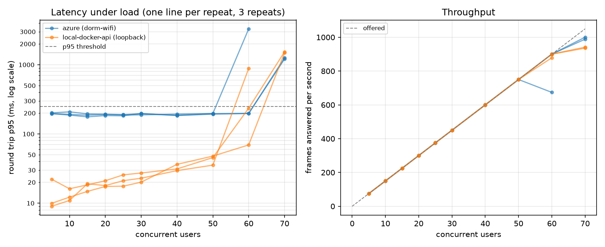

# Load test results

Generated by `experiments/loadtest/analyze.py` from `results/*.csv`. Each user streams real frames at 15 Hz; a step is measured after a warm-up. Capacity = the largest step that passed before the first failing step. Times in milliseconds; *API CPU* is `docker stats` for the API container (100 % = one core), when sampled.



## Capacity per repeat

| deployment | client network | session | repeat | capacity (users) | ramp ended by |
|---|---|---|---|---|---|
| azure | dorm-wifi | 20261019T110827Z | 0 | 50 | p95_exceeded at 60 |
| azure | dorm-wifi | 20261019T110827Z | 1 | 60 | p95_exceeded at 70 |
| azure | dorm-wifi | 20261019T110827Z | 2 | 60 | p95_exceeded at 70 |
| local-docker-api | loopback | 20261018T222944Z | 0 | 50 | p95_exceeded at 60 |
| local-docker-api | loopback | 20261018T222944Z | 1 | 60 | p95_exceeded at 70 |
| local-docker-api | loopback | 20261018T222944Z | 2 | 60 | p95_exceeded at 70 |

## Per step (median over repeats that reached it)

| deployment | client network | users | repeats | answered/s | offered/s | RTT p50 | RTT p95 | RTT p99 | server p95 | loss | API CPU | verdicts |
|---|---|---|---|---|---|---|---|---|---|---|---|---|
| azure | dorm-wifi | 5 | 3 | 75.0 | 75 | 73.1 | 197.4 | 210.9 | 1.02 | 0.00% | 11 % | ok x3 |
| azure | dorm-wifi | 10 | 3 | 150.0 | 150 | 71.1 | 191.4 | 207.4 | 1.00 | 0.00% | 18 % | ok x3 |
| azure | dorm-wifi | 15 | 3 | 224.9 | 225 | 67.0 | 187.0 | 202.7 | 1.02 | 0.00% | 25 % | ok x3 |
| azure | dorm-wifi | 20 | 3 | 299.9 | 300 | 70.7 | 191.4 | 207.3 | 1.03 | 0.00% | 29 % | ok x3 |
| azure | dorm-wifi | 25 | 3 | 375.0 | 375 | 68.7 | 188.7 | 206.5 | 1.03 | 0.00% | 37 % | ok x3 |
| azure | dorm-wifi | 30 | 3 | 450.0 | 450 | 96.1 | 196.8 | 222.1 | 1.04 | 0.00% | 47 % | ok x3 |
| azure | dorm-wifi | 40 | 3 | 600.0 | 600 | 67.2 | 185.9 | 206.1 | 1.04 | 0.00% | 62 % | ok x3 |
| azure | dorm-wifi | 50 | 3 | 750.0 | 750 | 87.0 | 196.3 | 225.5 | 1.04 | 0.00% | 75 % | ok x3 |
| azure | dorm-wifi | 60 | 3 | 900.1 | 900 | 87.6 | 198.4 | 243.3 | 1.03 | 0.00% | 88 % | ok x2, p95_exceeded x1 |
| azure | dorm-wifi | 70 | 2 | 994.5 | 1050 | 176.7 | 1234.9 | 1630.6 | 1.02 | 5.30% | 101 % | p95_exceeded x2 |
| local-docker-api | loopback | 5 | 3 | 74.9 | 75 | 5.8 | 10.0 | 13.6 | 1.64 | 0.00% | 11 % | ok x3 |
| local-docker-api | loopback | 10 | 3 | 150.0 | 150 | 6.7 | 12.2 | 17.4 | 1.43 | 0.00% | 20 % | ok x3 |
| local-docker-api | loopback | 15 | 3 | 224.9 | 225 | 8.1 | 18.4 | 37.7 | 1.36 | 0.00% | 28 % | ok x3 |
| local-docker-api | loopback | 20 | 3 | 300.0 | 300 | 8.5 | 17.9 | 31.0 | 1.31 | 0.00% | 36 % | ok x3 |
| local-docker-api | loopback | 25 | 3 | 375.2 | 375 | 9.5 | 21.1 | 40.5 | 1.22 | 0.00% | 43 % | ok x3 |
| local-docker-api | loopback | 30 | 3 | 450.0 | 450 | 10.3 | 22.9 | 44.0 | 1.22 | 0.00% | 52 % | ok x3 |
| local-docker-api | loopback | 40 | 3 | 600.0 | 600 | 13.1 | 31.2 | 58.1 | 1.09 | 0.00% | 65 % | ok x3 |
| local-docker-api | loopback | 50 | 3 | 749.9 | 750 | 16.4 | 45.6 | 116.9 | 1.04 | 0.00% | 81 % | ok x3 |
| local-docker-api | loopback | 60 | 3 | 899.8 | 900 | 22.5 | 235.8 | 630.9 | 1.03 | 0.01% | 97 % | ok x2, p95_exceeded x1 |
| local-docker-api | loopback | 70 | 2 | 938.6 | 1050 | 67.9 | 1512.9 | 1997.9 | 1.06 | 10.61% | 99 % | p95_exceeded x2 |

## Environment

`azure__dorm-wifi__20261019T110827Z`

```json
{
  "label": "azure",
  "network": "dorm-wifi",
  "target": "https://bukva-learning.duckdns.org",
  "health": {
    "status": "ok",
    "feature_version": 2,
    "classifier": "JoblibClassifier",
    "stub": false
  },
  "client_platform": "Windows-11-10.0.26200-SP0",
  "client_processor": "Intel64 Family 6 Model 170 Stepping 4, GenuineIntel",
  "client_python": "3.12.13",
  "websockets": "17.2",
  "send_hz": 15,
  "letter_seconds": 5.0,
  "steps": [
    5,
    10,
    15,
    20,
    25,
    30,
    40,
    50,
    60,
    70,
    80,
    100,
    130,
    160,
    200
  ],
  "warmup_seconds": 10.0,
  "window_seconds": 30.0,
  "reply_timeout_seconds": 5.0,
  "max_p95_ms": 250.0,
  "max_loss": 0.01,
  "max_send_lag_p95_ms": 40.0,
  "repeats": 3,
  "server_stats": true,
  "started_at": "20261019T110827Z"
}
```

`local-docker-api__loopback__20261018T222944Z`

```json
{
  "label": "local-docker-api",
  "network": "loopback",
  "target": "http://127.0.0.1:8002",
  "health": {
    "status": "ok",
    "feature_version": 2,
    "classifier": "JoblibClassifier",
    "stub": false
  },
  "client_platform": "Windows-11-10.0.26200-SP0",
  "client_processor": "Intel64 Family 6 Model 170 Stepping 4, GenuineIntel",
  "client_python": "3.12.13",
  "websockets": "17.2",
  "send_hz": 15,
  "letter_seconds": 5.0,
  "steps": [
    5,
    10,
    15,
    20,
    25,
    30,
    40,
    50,
    60,
    70,
    80,
    100,
    130,
    160,
    200
  ],
  "warmup_seconds": 10.0,
  "window_seconds": 30.0,
  "reply_timeout_seconds": 5.0,
  "max_p95_ms": 250.0,
  "max_loss": 0.01,
  "max_send_lag_p95_ms": 40.0,
  "repeats": 3,
  "server_stats": true,
  "started_at": "20261018T222944Z"
}
```
